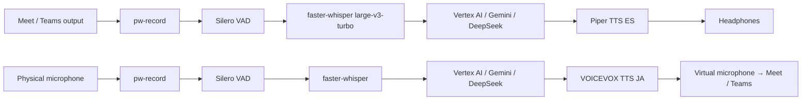

# JA ⇄ ES Live Interpreter

A bidirectional Japanese ⇄ Spanish interpreter for **Google Meet / Microsoft Teams** on Linux with **PipeWire**.

It captures the meeting audio, transcribes it, translates it, and plays the translated voice into your headphones — while your own speech is transcribed, translated into Japanese, and sent to a **virtual microphone** so the other participants hear you in Japanese.

It includes a **GTK4 desktop app** for starting/stopping, choosing devices, reading live transcription, showing large subtitles, and running diagnostics.

> **Use headphones.** With speakers, the interpreter can hear its own output and loop.

[Español](README.es.md) · [Architecture](ARCHITECTURE.md) · [Design notes](docs/design.md) · [Changelog](docs/CHANGELOG.md)

## What it does

- **Listen (JA → ES):** captures the meeting output, transcribes Japanese, translates to Spanish, and plays the Spanish voice only in your headphones, with the original Japanese at low volume underneath.
- **Speak (ES → JA):** captures your physical microphone, transcribes Spanish, translates to Japanese, synthesizes speech, and routes it to a virtual microphone.
- **Both directions at once:** the two channels can run simultaneously with separate audio nodes.
- **Desktop UI:** meeting/settings/diagnostics tabs, live transcript, subtitles, voice preview.
- **Local audio:** voice never leaves the machine; only text is sent to the translation provider.

## Architecture



The audio graph is built with PipeWire/WirePlumber nodes (`meet_in`, `meet_out`, `meet_mic`). The application does not modify the system configuration without an explicit command; setup and removal are scripted and reversible.

## Requirements

- Arch Linux with PipeWire + WirePlumber (tested on the reference laptop).
- Python **3.14**.
- NVIDIA GPU with CUDA 12 for STT (CPU fallback is slower).
- `ffmpeg` in `PATH`.
- [VOICEVOX Engine](https://github.com/VOICEVOX/voicevox_engine) for Japanese TTS (rootless install script included).
- [Piper](https://github.com/OHF-Voice/piper1-gpl) for Spanish TTS (rootless install script included).

## Install

```bash
python3.14 -m venv .venv
. .venv/bin/activate
pip install -e '.[dev]'

# Vertex AI (optional; Gemini API and DeepSeek are also supported)
export GCP_ACCOUNT='you@example.com'
export GCP_PROJECT='your-gcp-project'
./scripts/gcp-setup.sh

# Japanese voice (rootless, ~1.8 GB)
./scripts/install-voicevox.sh

# Spanish voice (rootless)
./scripts/install-piper.sh

# PipeWire graph
./scripts/interprete-audio setup
./scripts/interprete-audio verify

# Desktop launcher (rootless, reversible)
./scripts/install-gui.sh
```

For Gemini API instead of Vertex AI:

```bash
export GEMINI_API_KEY='...'
# config.toml: provider = "gemini"
```

## Use

```bash
interprete gui          # desktop app
interprete doctor       # check nodes, devices, VOICEVOX, Piper, STT, Vertex
interprete listen       # JA → ES only
interprete speak        # ES → JA only
```

In Meet/Teams:

1. **Speaker:** `Meet in` — the interpreter captures the other participants.
2. **Microphone:** `Meet mic` — the others receive your translated voice. Do **not** select your physical microphone in Meet.
3. Disable echo cancellation and noise suppression; they can cut the synthesized voice.

## Tests

```bash
.venv/bin/python -m pytest -q
```

The suite currently collects **185 tests**. It covers routing, VAD segmentation, translation-provider contracts, Piper/VOICEVOX adapters, configuration, and the GTK-facing view models. Hardware-dependent tests are skipped when the machine does not have the required device or model.

## Measured latency

Measured on the reference laptop (Ryzen 7 6800H, RTX 3050 Ti 4 GB, 14 GiB RAM), from the end of a phrase:

| Path | First translated audio | Full utterance |
|---|---:|---:|
| JA → ES | ~1.27 s | ~1.48 s |
| ES → JA | ~1.53 s | ~1.84 s |

The design target is **2–4 s** from the end of a phrase. These numbers are not a guarantee for other hardware or network conditions; see [`docs/latency.md`](docs/latency.md) for the per-stage measurements.

## Demo

No demo recording is included. The project is documented through the architecture, the test suite and the source; a real recording would require a live meeting, audio devices and the GPU setup described above.

No mock screenshot is shipped in place of a real recording.

## How it was built

The project uses an AI-assisted workflow with a written contract:

- `AGENTS.md` defines the rules, invariants, and honesty requirements for coding agents.
- `docs/plans/` contains phased plans with explicit gates.
- Tests are the safety net; hardware-dependent behavior is marked and skipped when it cannot be verified.
- Every code change is recorded in `docs/CHANGELOG.md`; architectural decisions live in `docs/design.md`.
- The human reviews the diff and runs the end-to-end checks before accepting a phase.

AI tools used during development include OpenCode and Claude Code, with Gemini/Vertex AI as the translation provider.

## Limits

- Linux + PipeWire only; macOS and Windows are not supported.
- The desktop UI is GTK4/libadwaita; it expects a GTK 4.x desktop session.
- Voicevox and Piper are external engines/models; their licenses and voice terms apply separately.
- Translation quality depends on the provider and the domain glossary; it is not a substitute for a professional interpreter.
- The project is a working prototype, not a certified accessibility or interpretation product.
- Latency depends on GPU, model cache, network, and provider region.

## Privacy

The default translation provider is Google Gemini through Vertex AI: the **text** of the conversation is sent to Google. Audio is processed locally and is not uploaded by this application. DeepSeek and Gemini API are alternatives; review their terms before using confidential material. Do not use the tool for content you are not allowed to send to the selected provider.

## License

GNU General Public License v3.0 or later. See [`LICENSE`](LICENSE) and [`THIRD-PARTY.md`](THIRD-PARTY.md).

The GPL choice is required by the `piper-tts` dependency, which is GPL-3.0-or-later. VOICEVOX, Piper voices, FFmpeg, GTK, and libadwaita are external components with their own licenses; they are not bundled in this repository.
